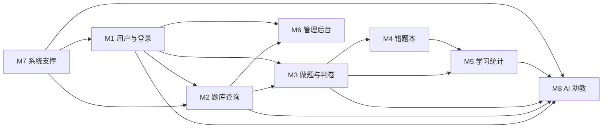

# AI 助教模块（M8）设计说明

> 用户自带 API Key（BYOK）的 AI 助教：深度解析题目、生成同考点变式题、诊断薄弱知识点。
> 配图：`docs/diagrams/总功能结构图-AI版.png`（结构图）、`AI助教模块架构图.png`（技术方案）。

---

## 1. 结构图发生了什么变化

| 变化 | 内容 |
| --- | --- |
| **新增一级模块** | `M8 AI 助教（P1 加分项）`，挂在根节点下，与 M1–M7 同级 |
| **M7 系统支撑增强** | 新增 3 个技术能力：`密钥加密存储`、`限流 / 超时 / 重试`、`SSE 流式响应` |
| **新增依赖边** | M8 依赖 M1（用户身份）、M2（题目上下文）、M3（答题记录）、M5（统计聚合）、M7（底座） |
| **优先级不变** | P0 仍是 M7 → M1 → M2；M8 属于"做完主功能再加分"，不阻塞第一批 |



---

## 2. M8 功能点

| 子功能 | 说明 | 前置依赖 | 建议顺序 |
| --- | --- | --- | --- |
| **AI 密钥管理** | 用户填写 provider / baseUrl / model / apiKey；加密存储；脱敏展示；连通性测试；删除 | M1 | 第 1 步 |
| **AI 深度解析** | 对当前题目：考点、每个选项对错原因、易错点、解题步骤（流式输出） | M2 | 第 2 步 |
| **AI 多轮追问** | 基于当前题目和已有解析继续提问，保留上下文（限制轮数/长度） | M2 + 解析 | 第 3 步 |
| **AI 变式题生成** | 同考点生成变式题（改数字/改条件/改问法），带答案与解析；进入"待审核草稿" | M2（+M6 审核入库） | 第 4 步 |
| **AI 学情诊断** | 基于答题记录聚合：薄弱知识点、错误类型分布、复习建议 | M3、M5 | 第 5 步 |
| **调用记录与配额** | 每次调用记录模型、Token、耗时、状态；限制频率与单日次数 | M7 | 贯穿 |

---

## 3. 数据表设计

```sql
-- 用户自己的模型配置（一个用户可配多个供应商）
CREATE TABLE t_ai_config (
  id             BIGINT AUTO_INCREMENT PRIMARY KEY,
  user_id        BIGINT       NOT NULL,
  provider       VARCHAR(30)  NOT NULL,          -- deepseek / openai / qwen / custom
  base_url       VARCHAR(200) NOT NULL,          -- 兼容 OpenAI 协议的地址
  model          VARCHAR(60)  NOT NULL,
  api_key_cipher TEXT         NOT NULL,          -- AES-GCM 密文，绝不明文
  enabled        TINYINT      DEFAULT 1,
  create_time    DATETIME     DEFAULT CURRENT_TIMESTAMP,
  update_time    DATETIME     DEFAULT CURRENT_TIMESTAMP ON UPDATE CURRENT_TIMESTAMP,
  UNIQUE KEY uk_user (user_id)
);

-- 每次 AI 调用（审计、用量、限流依据）
CREATE TABLE t_ai_record (
  id           BIGINT AUTO_INCREMENT PRIMARY KEY,
  user_id      BIGINT      NOT NULL,
  biz_type     VARCHAR(20) NOT NULL,   -- ANALYZE / VARIANT / DIAGNOSE / CHAT
  question_id  BIGINT      NULL,
  prompt_hash  CHAR(64)    NULL,       -- 只存摘要，不存完整提示词，省空间也避免泄题
  model        VARCHAR(60),
  tokens_in    INT DEFAULT 0,
  tokens_out   INT DEFAULT 0,
  status       VARCHAR(10),            -- SUCCESS / FAIL
  error_msg    VARCHAR(200),           -- 已脱敏
  cost_ms      INT,
  create_time  DATETIME DEFAULT CURRENT_TIMESTAMP,
  KEY idx_user_time (user_id, create_time)
);

-- AI 生成的变式题先进草稿，人工确认后才进正式题库
CREATE TABLE t_variant_draft (
  id           BIGINT AUTO_INCREMENT PRIMARY KEY,
  user_id      BIGINT NOT NULL,
  source_qid   BIGINT NOT NULL,
  stem         TEXT,
  options      JSON,
  answer       VARCHAR(10),
  analysis     TEXT,
  status       VARCHAR(10) DEFAULT 'PENDING',  -- PENDING / APPROVED / REJECTED
  create_time  DATETIME DEFAULT CURRENT_TIMESTAMP
);
```

---

## 4. 接口设计

| 方法 | 路径 | 说明 |
| --- | --- | --- |
| POST | `/api/ai/config` | 绑定/更新 Key（入参 apiKey，服务端立即加密） |
| GET | `/api/ai/config` | 返回 `provider/baseUrl/model/掩码Key`，**永不返回明文** |
| POST | `/api/ai/config/test` | 连通性测试（发一次最小请求） |
| DELETE | `/api/ai/config` | 解绑并删除 |
| GET | `/api/ai/analyze/{questionId}` | **SSE 流式**返回题目深度解析 |
| POST | `/api/ai/chat` | 多轮追问（带 sessionId） |
| POST | `/api/ai/variant` | 生成变式题草稿（数量可配） |
| GET | `/api/ai/diagnose` | 学情诊断（薄弱知识点 + 建议） |
| GET | `/api/ai/records` | 调用记录与 Token 用量 |

统一返回仍复用 `Result`；流式接口用 `SseEmitter`（Spring MVC 原生支持），事件格式：`data: {"delta":"..."}`。

---

## 5. BYOK 安全与工程约束（答辩重点）

| 风险 | 措施 |
| --- | --- |
| Key 泄露 | 服务端 AES-GCM 加密存储；返回前端只给掩码 `****abcd`；日志/异常脱敏 |
| 主密钥泄露 | 加密主密钥放环境变量 `AI_KEY_SECRET`，不写进代码与 Git |
| 前端直连模型 | **禁止**：浏览器直连会暴露 Key 且跨域；统一走服务端代理 |
| 提示词注入 | 题目内容视为不可信输入；系统提示词固定，用户文本做转义与长度限制 |
| 费用失控 | 按用户限流（如 20 次/天）、单次 max_tokens 上限、失败重试上限 |
| 隐私 | 只发送当前题目与必要的作答信息，不发送用户资料 |
| 内容可信度 | 页面标注"AI 生成内容仅供参考，以官方答案为准"；变式题需人工审核入库 |
| 供应商兼容 | 统一走 OpenAI 兼容协议（DeepSeek / 通义 / 智谱 / OpenAI 都支持） |

---

## 6. 实施顺序建议

```text
M1（用户身份）→ M2（题库查询）
      ↓
① AI 密钥管理（1 天：表 + 加密工具 + 配置接口 + 页面）
      ↓
② AI 深度解析（2 天：Prompt 模板 + SSE + 记录）      ← 最小可演示闭环
      ↓
③ 多轮追问（1 天）
      ↓
④ 变式题生成（2 天：草稿表 + 审核入库）
      ↓
⑤ 学情诊断（2 天：依赖 M3 答题记录/M5 统计，放最后）
```

**答辩策略**：先把 ①② 做出来（"AI 解析当前题目"最直观、依赖最少），③④⑤ 作为规划写进文档；这样即使时间不够，也有可演示的亮点。

---

## 7. 常见追问与回答

**Q：为什么让用户自带 Key，而不是平台统一提供？**
> 课程项目没有预算和备案要求，BYOK 把成本与合规责任交给用户；对用户也更灵活（可自选模型）。技术上通过"服务端代理 + 加密存储"保证 Key 不暴露。

**Q：为什么不让浏览器直接调模型？**
> 浏览器直连会把 Key 暴露在前端代码里，且会遇到跨域；服务端代理还能统一做限流、审计、Prompt 管理与内容过滤。

**Q：AI 生成的答案错了怎么办？**
> 解析标注"仅供参考"；变式题进入待审核草稿，管理员确认后才入题库；判卷永远以题库标准答案为准，AI 不参与判分。

**Q：这一块算不算超纲/加分？**
> 属于课程外的工程拓展，作为加分项；不影响 P0 验收，反而体现"模块化 + 安全设计"的工程能力。
