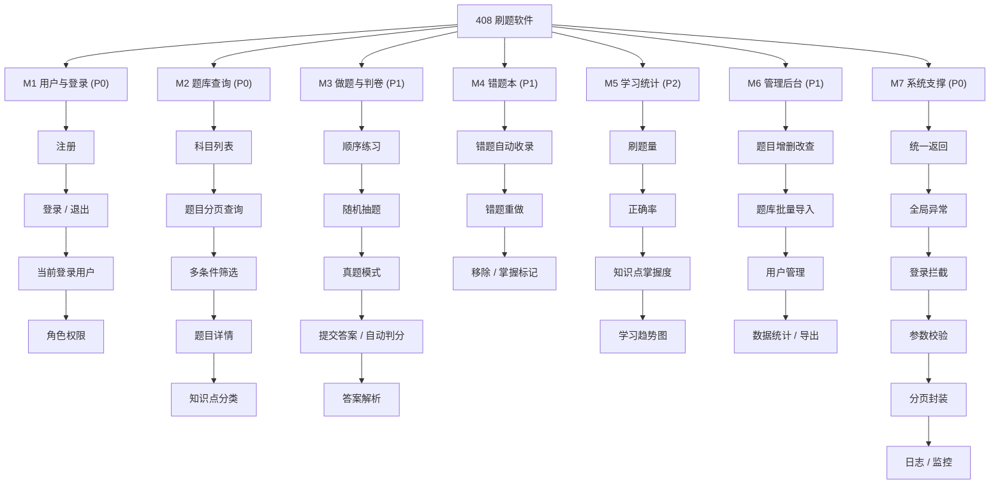
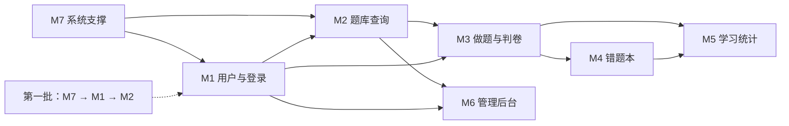

# 统考 408 刷题软件 · 功能模块结构

> 面向 SpringBoot 课程小组作业的完整模块划分。**P0 = 第一批交付**（用户 + 题库查询），其余为后续迭代。
> 配图：`docs/diagrams/总功能结构图.png`（树状）、`总功能结构图-脑图.png`（彩色脑图，绿=P0）。

---

## 1. 总览（Mermaid 版，可直接贴进 Markdown 文档）

---

## 2. 模块清单

| 模块 | 功能点 | 优先级 | 依赖 | 主要接口（规划） |
| --- | --- | --- | --- | --- |
| **M1 用户与登录** | 注册、登录、退出、当前用户、角色（学生/管理员） | **P0** | M7 | `POST /api/auth/register`、`/login`、`/logout`、`GET /api/auth/me` |
| **M2 题库查询** | 科目列表、题目分页、多条件筛选（科目/难度/年份/关键词）、题目详情、知识点 | **P0** | M1、M7 | `GET /api/subjects`、`GET /api/questions`、`GET /api/questions/{id}` |
| **M3 做题与判卷** | 顺序练习、随机抽题、真题模式、提交答案、自动判分、解析展示 | P1 | M1、M2 | `POST /api/practice/submit`、`GET /api/practice/next` |
| **M4 错题本** | 错题自动收录、错题重做、移除/掌握标记 | P1 | M3 | `GET /api/wrong-book`、`DELETE /api/wrong-book/{id}` |
| **M5 学习统计** | 刷题量、正确率、知识点掌握度、学习趋势图 | P2 | M3、M4 | `GET /api/stats/overview`、`/stats/knowledge` |
| **M6 管理后台** | 题目增删改查、题库批量导入、用户管理、数据导出 | P1 | M1、M2 | `POST/PUT/DELETE /api/admin/questions`、`POST /api/admin/import` |
| **M7 系统支撑** | 统一返回、全局异常、登录拦截、参数校验、分页封装、日志监控 | **P0** | 无 | 无独立接口，被所有模块复用 |

---

## 3. 模块依赖与迭代顺序

**迭代顺序**：M7（骨架）→ M1（身份）→ M2（数据）→ M3（核心业务）→ M4 / M6（并行）→ M5（汇总展示）。

---

## 4. 数据表规划（完整版）

| 表 | 主要字段 | 归属模块 | 状态 |
| --- | --- | --- | --- |
| `t_user` | id、username、password(BCrypt)、nickname、role、create_time | M1 | ✅ 已建 |
| `t_subject` | id、code(DS/CO/OS/CN)、name | M2 | 第二批 |
| `t_question` | id、subject_id、knowledge_point、type、stem、option_a~d、answer、analysis、difficulty、exam_year | M2 | 第二批 |
| `t_answer_record` | id、user_id、question_id、user_answer、is_correct、answer_time | M3 | 第三批 |
| `t_wrong_book` | id、user_id、question_id、wrong_count、last_wrong_time、mastered | M4 | 第三批 |
| `t_favorite` | id、user_id、question_id、create_time | M3 扩展 | 可选 |

---

## 5. 当前进度（对照第一批）

| 模块 | 进度 | 说明 |
| --- | --- | --- |
| M7 系统支撑 | ✅ 大部分完成 | `Result`、`BizException`、全局异常、参数校验、SQL 日志已具备；登录拦截器待补 |
| M1 用户与登录 | ✅ 核心完成 | 注册、登录、三种反馈、BCrypt、Session 已通；退出/当前用户待补 |
| M2 题库查询 | ⏳ 未开始 | 第二批做（`t_subject`、`t_question` + 分页查询） |
| M3–M6 | ⏳ 未开始 | 第三批及以后 |

---

## 6. 答辩一句话

> 系统按"身份 → 数据 → 业务 → 汇总"拆成 7 个模块：M1 用户与登录解决"你是谁"，M2 题库查询解决"你能看什么"，M3 做题判卷解决"怎么练"，M4/M5 沉淀错题与统计，M6 提供管理能力，M7 是被所有人复用的技术底座。第一批先交付 M7 + M1 + M2，因为它们是后续所有模块的前置依赖，且风险最低、可演示。
