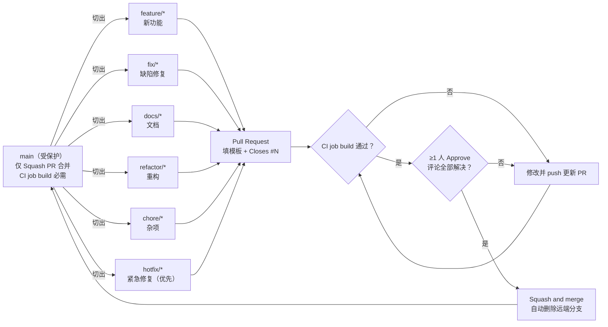

# 统考 408 刷题软件 · 协作规范

> 适用仓库：<https://github.com/jjxxli/user-module>（public，默认分支 `main`，受保护）
> 适用对象：课程小组全体成员（Owner：`jjxxli`）
> 维护方式：规范变更走 `docs/` 分支 + PR，经 Owner 合并后生效；本文件与 [README.md](../README.md)、[CONTRIBUTING.md](../CONTRIBUTING.md)、[新成员接入指南.md](新成员接入指南.md) 保持一致。

> ⚠️ **当前仓库采用「简单模式」**：`main` 允许直接 `push`（仅禁止 force push / 删除分支），不强制 PR、评审和 CI 门禁。
> 本文档以下内容是**严格模式**的完整规范（推荐做法）。组员到齐、进入多人并行迭代后，按下面 3 步切换启用：
> 1. 每台机器装钩子：`git config core.hooksPath .githooks`（或运行 `scripts/install-hooks.ps1`）；
> 2. GitHub → `Settings → Branches → main`：勾选「Require a pull request before merging」（1 人 Approve）与「Require status checks to pass → build」；
> 3. 全体按本文档「分支 → PR → 评审 → Squash 合并」流程协作。

---

## 1. 目的与原则

课程项目时间短、多人并行，协作规范只解决三件事：**改动不互相踩踏、代码质量可控、问题可追溯**。

四条原则：

1. **main 永远可构建**：任何时刻 `main` 上的代码都能通过 CI、能启动、能演示。
2. **小步快跑**：小分支、小提交、小 PR，评审成本低、冲突少、出问题好回滚。
3. **先评审后合并**：任何人（包括 Owner）都不能绕过 PR 直接改 `main`。
4. **安全第一**：密钥、密码、Token 永不入仓；发现泄露立即处理并轮换。

---

## 2. 基本约定速览

| 项目 | 约定 |
| --- | --- |
| 主分支 | `main`，受保护，只能通过 PR 合并 |
| 短期分支前缀 | `feature/`、`fix/`、`docs/`、`refactor/`、`chore/`、`hotfix/`（小写英文 kebab-case） |
| 提交格式 | Conventional Commits：`type(scope): 中文 subject`（≤50 字，不加句号） |
| 关联 Issue | 提交或 PR 描述中写 `Closes #N` |
| PR 要求 | 按 PR 模板完整填写、CI job `build` 通过、≥1 人 Approve、评论全部解决 |
| 合并方式 | 仅 **Squash and merge**，合并后自动删除分支 |
| 评审 SLA | 24 小时内给首轮意见，48 小时内完成评审 |
| CI | GitHub Actions，JDK 17 Temurin，`./mvnw -B -ntp verify` |
| 本地钩子 | `core.hooksPath=.githooks`（pre-commit / commit-msg / pre-push） |
| 发布 | 语义化版本 tag（从 `v0.1.0` 起），仅 Owner 执行 |
| 安全红线 | 禁止提交任何密码 / 密钥 / 私钥 / Token |

---

## 3. 角色与职责

| 角色 | 人员 | 职责 |
| --- | --- | --- |
| **Owner（仓库管理员）** | `jjxxli` | 仓库设置与分支保护、把 CI 的 `build` 设为必需检查、限制只允许 Squash 合并并自动删分支、维护 Issue / PR 模板与 `.github/CODEOWNERS`、合并 PR、打 tag 与发布 Release、处理安全事件与最终争议 |
| **模块负责人** | 组内成员（按 Issue 认领） | 对自己模块的需求拆解、实现、自测、文档更新；及时响应评审请求；对模块内代码质量负责 |
| **Reviewer** | 全体成员（互为评审） | 按检查清单评审 PR，给具体、可执行的修改意见；24 小时内响应；不读 diff 不 Approve |

模块归属（与 `docs/功能模块结构.md` 的划分一致，人员由 Owner 在 Issue 中分配）：

| 模块 | 范围 | 优先级 |
| --- | --- | --- |
| M1 用户与登录 | 注册、登录、退出、当前用户、角色 | P0 |
| M2 题库查询 | 科目、题目分页/筛选、题目详情 | P0 |
| M3 做题与判卷 | 练习、提交答案、自动判分、解析 | P1 |
| M4 错题本 | 错题收录、重做、掌握标记 | P1 |
| M5 学习统计 | 刷题量、正确率、知识点掌握度、趋势 | P2 |
| M6 管理后台 | 题目管理、批量导入、用户管理 | P1 |
| M7 系统支撑 | 统一返回、全局异常、登录拦截、参数校验、分页、日志 | P0 |
| M8 AI 助教（加分） | BYOK 密钥管理、深度解析、追问、变式题、学情诊断 | P1 |

**Owner 的 PR 也需要评审**：Owner 自己的 PR 必须至少有 1 名成员 Approve 后才能合并；Owner 负责最终合并动作。

---

## 4. 分支模型

### 4.1 模型图



### 4.2 分支规则

1. **只有 `main` 是长期分支**，其他分支都是短期分支，生命周期建议 **≤ 3 天**；预计超过 1 周的工作先拆成多个 Issue / PR。
2. `main` 分支保护规则（Owner 配置）：
   - 禁止直接 push，禁止 force push，禁止直接删除；
   - 合并前必须通过 CI 的 `build` 检查；
   - 至少 1 个 Approve，且所有对话评论已解决；
   - 只允许 `Squash and merge`，合并后自动删除分支。
3. 切分支前先同步最新 `main`：

   ```bash
   git switch main
   git pull --ff-only origin main
   git switch -c feature/login-jwt
   ```

4. 分支命名：`<type>/<小写英文-kebab-case>`，2～4 个单词，见名知意。

| 前缀 | 用途 | 示例 |
| --- | --- | --- |
| `feature/` | 新功能 | `feature/login-jwt`、`feature/question-page` |
| `fix/` | 缺陷修复 | `fix/register-dup` |
| `docs/` | 文档 | `docs/update-readme` |
| `refactor/` | 重构 | `refactor/user-service` |
| `chore/` | 构建 / 依赖 / 配置 | `chore/upgrade-deps` |
| `hotfix/` | 紧急修复（从 `main` 切出） | `hotfix/login-500` |

5. `hotfix/` 用于影响演示 / 答辩的紧急问题：从 `main` 切出、PR 标注 `紧急`、优先评审，合并后按需发布补丁版本（如 `v0.1.1`）。

---

## 5. 提交规范

### 5.1 格式

```text
<type>(<scope>): <subject>

<body（可选，解释为什么改、改了什么影响）>

<footer（可选，Closes #12）>
```

强制要求：

- `type` 与 `scope` 小写；冒号为英文半角，冒号后一个空格；
- `subject` 用中文，**不超过 50 字**，描述做了什么，**不加句号**；
- 一个提交只做一件可独立说明的事；
- 涉及 Issue 时在 footer 写 `Closes #12`（PR 描述中写同样有效）；
- 提交信息由 `.githooks/commit-msg` 校验，不符合会被本地拒绝。

### 5.2 type 表

| type | 含义 | 示例 |
| --- | --- | --- |
| `feat` | 新功能 | `feat(auth): 实现登录接口并写入 Session` |
| `fix` | 修复缺陷 | `fix(user): 修复重复用户名并发注册返回 500` |
| `docs` | 仅文档 | `docs: 补充新成员接入指南` |
| `style` | 格式（不影响逻辑） | `style: 统一缩进为 4 空格` |
| `refactor` | 重构（不改外部行为） | `refactor(user): 拆分注册校验逻辑` |
| `perf` | 性能优化 | `perf(user): 用户名查询增加索引` |
| `test` | 测试 | `test(auth): 补充登录失败用例` |
| `build` | 构建 / 依赖 | `build(deps): 升级 MyBatis 到 3.0.3` |
| `ci` | CI 配置 | `ci: 缓存 Maven 依赖` |
| `chore` | 杂项 | `chore: 更新 .gitignore` |
| `revert` | 回滚提交 | `revert: 回滚登录接口改动` |

### 5.3 scope 建议

| scope | 范围 |
| --- | --- |
| `auth` | 注册 / 登录 / 会话 |
| `user` | 用户业务、Service、Mapper |
| `common` | `common/`（Result、异常、全局处理） |
| `config` | `config/`、`application*.yml` |
| `docs` | README、CONTRIBUTING、`docs/` |
| `ci` | `.github/`、`.githooks/`、`scripts/` |
| `deps` | `pom.xml` 依赖 |

> 其他 scope 也可用（如 `question`、`practice`），保持小写短单词即可；拿不准时选最接近的，不要造超长 scope。

### 5.4 校验与自检

```bash
# 提交前看本次改动
git status
git diff --cached

# 提交（信息要符合规范）
git commit -m "feat(auth): 实现登录接口并写入 Session" -m "Closes #12"
```

- 钩子会在本地拦截：`main` 上直接提交、>5 MB 文件、敏感文件（`*.env`、`*.pem`、`*.key`、`id_rsa*`、`application-local.yml` 等）、行尾空白 / 冲突标记、格式不合规的提交信息。
- **禁止使用 `--no-verify` 跳过钩子**；确需调整钩子规则时，提 `chore` PR 修改 `.githooks/`。

---

## 6. PR 规范

### 6.1 PR 标题与描述

- 标题与提交信息格式一致，例如：`feat(auth): 实现登录接口并写入 Session`。
- 必须完整填写 `.github/PULL_REQUEST_TEMPLATE.md`；其中以下六项是核心内容：

| 段落 | 内容要求 |
| --- | --- |
| **变更内容** | 改了什么、为什么改；必要时拆点列出 |
| **关联 Issue** | `Closes #12`（多个用 `Closes #12, Closes #13`） |
| **变更类型** | 勾选对应的 type（feat / fix / docs / refactor / test / ci / build / chore / perf / style 等） |
| **自测方式** | 执行的命令、调用的接口、预期结果；涉及接口附请求/响应示例或截图 |
| **影响范围与兼容性** | 影响的模块、接口、数据库表、配置项、其他成员需要注意的地方 |
| **提交前检查清单** | 逐项勾选：verify 通过、无敏感文件、分层与异常规范、文档同步、提交信息合规 |

- 草稿 PR 可用 Draft 状态，但**不要在未完成时请求评审**；准备好后改为 Ready for review。
- PR 描述要让 Reviewer 不打开代码也能理解「为什么改、怎么验证」。

### 6.2 PR 规模与拆分

- 单个 PR 建议改动 **≤ 400 行**（不含自动生成文件），提交数 ≤ 10。
- 一个 PR 只做一件事：功能、修复、文档、依赖升级分开提；重构和行为变更分开提。
- 涉及数据库结构变更（新增表 / 字段）时，必须在 PR 中说明升级脚本与回滚方式。

### 6.3 PR 合并条件（全部满足）

- [ ] CI 的 `build` job 通过（绿灯）；
- [ ] 至少 **1 名非作者成员 Approve**；
- [ ] 所有 review 评论已解决或已明确回复；
- [ ] 标题与描述符合模板，关联了 Issue；
- [ ] 无冲突（已 rebase 最新 `main`）；
- [ ] 无敏感信息、无大文件、无无关改动。

合并方式：**Squash and merge**（把 PR 的所有提交压成一个符合规范的提交），**合并后自动删除远端分支**。

---

## 7. 评审规范与 SLA

### 7.1 时效

| 事件 | 目标时限 |
| --- | --- |
| Reviewer 首次响应（评论或 Approve） | **24 小时内** |
| 完整评审结论（Approve / Request changes） | **48 小时内** |
| 作者响应评审意见 | **24 小时内** |
| 合并（条件满足后） | Owner 在 **24 小时内**完成 |

### 7.2 评审重点（按优先级）

1. **正确性**：逻辑是否符合 Issue、边界条件（空值、重复、并发）是否处理。
2. **安全性**：无密码 / 密钥入库或入日志；SQL 用 `#{}`；统一异常不泄露堆栈。
3. **分层与可维护性**：Controller 不写业务、Service 不碰请求对象、DTO 与 Entity 分离、SQL 在 XML。
4. **测试与回归**：新增业务有测试，测试走 `test` profile（H2），`verify` 通过。
5. **一致性**：返回 `Result`、异常走 `BizException`、接口变更同步 `api-test.http` 与文档。
6. **风格**：遵守 `.editorconfig`；不阻塞合并的小问题用 `[建议]` 标注。

### 7.3 评论约定

- 统一前缀：`[必须修改]`（阻塞合并）/ `[建议]`（作者自行决定）/ `[提问]`（请求解释）。
- 评论要具体到文件与行号，给出修改建议或示例，不写「这里不太好」这类无法执行的评论。
- 作者对每条评论回复；改完 push 后在 PR 里说明「已处理」，并重新请求评审。
- **禁止**未经阅读直接 Approve；**禁止** Reviewer 代替作者改代码后直接合并。
- 仓库通过 `.github/CODEOWNERS` 自动指派审查人（当前默认 Owner 兜底；组员确定后按模块补充）。若分支保护启用了「Require review from Code Owners」，CODEOWNERS 中的负责人必须 Approve。

### 7.4 评审结论

- **Approve**：满足合并条件，可以合并；
- **Request changes**：存在 `[必须修改]` 项，修复并重新评审后再 Approve；
- **Comment**：仅提问 / 讨论，不代表通过。

---

## 8. 合并与分支清理

### 8.1 合并

- 由 Owner 执行 **Squash and merge**；提交标题使用 PR 标题（必须符合 Conventional Commits）。
- 合并前确认 PR 已 rebase 到最新 `main`，冲突已在作者分支解决。
- 合并后检查 `main` 的 CI 是否仍为绿色；红则立即排查，必要时 revert。

### 8.2 分支清理

- 远端分支由 GitHub 在合并后自动删除（Owner 已在仓库设置中开启）。
- 本地清理：

```bash
# 删除已合并的本地分支
git switch main
git pull --ff-only origin main
git branch -d feature/login-jwt

# 清理远端已删除分支的本地引用
git fetch --prune
```

- 被拒绝 / 废弃的分支：作者主动删除远端（`git push origin --delete <branch>`）并在 Issue 说明。
- 分支存活超过 3 天未开 PR 的，要在周会同步进度或拆分。

---

## 9. CI 门禁

### 9.1 Workflow

| 项 | 值 |
| --- | --- |
| 平台 | GitHub Actions |
| 配置文件 | `.github/workflows/ci.yml` |
| Workflow 名 | `CI` |
| Job id / name | **`build`**（分支保护把它设为必需检查） |
| 触发条件 | push 到 `main`、pull_request 到 `main`、手动 `workflow_dispatch` |
| 运行环境 | `ubuntu-latest` |
| JDK | Temurin **17**（`actions/setup-java@v4`，开启 Maven 缓存） |
| 关键步骤 | checkout → setup-java → `chmod +x ./mvnw` → `./mvnw -B -ntp verify` |
| 权限 | `contents: read` |
| 并发 | 同一分支只跑最新一次（`cancel-in-progress: true`） |

### 9.2 门禁规则

- PR 必须等 `build` 通过才能合并；**红色 CI 一律不允许合并**（包括 Owner 自己的 PR）。
- 本地必须能复现 CI 结果：

```powershell
.\mvnw.cmd -B -ntp verify
```

```bash
./mvnw -B -ntp verify
```

- 测试使用 `test` profile（H2 内存库，见 `application-test.yml`），不依赖 MySQL；CI 环境没有数据库，测试必须自给自足。
- 不要在 CI 里跳过测试（如 `-DskipTests`）来让绿灯，测试失败要修测试或修代码。
- Dependabot 自动升级 PR 同样需要走 `build` + 评审；依赖升级合并前至少本地跑一次 `verify`。

---

## 10. 配置、密钥与安全红线

### 10.1 配置外置约定

- `application.yml`：**只放公共配置和占位符**，形如 `${MYSQL_PASSWORD:}` / `${MYSQL_URL:默认值}`，会提交到仓库。
- `application-local.yml`：本机真实数据库账号密码写这里，已被 `.gitignore` 忽略，模板是 `application-local.yml.example`；**任何情况下不提交**。
- `application-test.yml`：测试 / CI 专用（H2 内存库 + `db/schema.sql`、`db/data.sql`），测试类加 `@ActiveProfiles("test")`。
- 其他敏感配置（AI Key 主密钥等）走环境变量（如 `AI_KEY_SECRET`），参照 `docs/AI助教模块设计.md`。

### 10.2 安全红线（违反即回滚）

1. 禁止把任何密码、API Key、Token、私钥、证书提交到仓库（包括代码、配置、测试、文档、提交信息、截图）。
2. 禁止把密码明文或 BCrypt 密文返回给前端，禁止把敏感信息写进日志 / 异常信息。
3. 禁止直接 push `main`、禁止对共享分支 force push、禁止 `--no-verify` 绕过钩子。
4. 禁止把大文件（> 5 MB）提交进仓库。
5. 禁止浏览器直连第三方模型（AI Key 会暴露），必须走服务端代理。

### 10.3 发现泄露怎么办

1. **立即**在群里通知 Owner，说明泄露的文件 / 提交 / 时间范围；
2. 立即轮换（更换）对应密码 / Key，旧凭据作废；
3. 删除仓库中的敏感内容，并评估是否需要清理历史（`git filter-repo` 等，由 Owner 执行）；
4. 记录处理过程，在周会复盘；
5. **不要只删掉最新提交就认为安全**——历史提交仍可被拉取。

---

## 11. Issue 与任务管理

- 所有工作先有 Issue：需求、缺陷、文档、CI 配置都可以建 Issue。
- 新建 Issue 必须使用仓库模板（空白 Issue 已禁用）：Bug 报告 / 功能需求 / 开发任务（`task.yml`，含任务目标、改动范围、完成标准 DoD、负责人、分支名）。
- 标题：模板前缀后补充简述，如 `[task] 实现登录接口并写入 Session`、`[M1] 登录接口增加 Session 超时提示`；正文包含背景、验收标准、涉及文件 / 接口、参考文档。
- 领取：评论说明并把自己设为 Assignee；同一 Issue 只有一个负责人，必要时拆分。
- 关联：PR 标题 / 描述写 `Closes #N`，合并时自动关闭 Issue。
- 状态维护：进行中 / 阻塞 / 完成在 Issue 或看板更新；阻塞要写清原因与需要的帮助。
- 建议标签：`bug`、`enhancement`、`documentation`、`good first issue`（GitHub 默认标签）。

---

## 12. 发布与版本管理

### 12.1 版本号

采用语义化版本 `vMAJOR.MINOR.PATCH`：

- `MAJOR`：不兼容的接口 / 数据变更（课程项目基本不动）；
- `MINOR`：新增功能（模块交付）；
- `PATCH`：缺陷修复。

课程项目版本规划：

| 版本 | 内容 |
| --- | --- |
| `v0.1.0` | 第一批交付：M7 系统支撑 + M1 用户与登录（+ M2 题库查询如已完成） |
| `v0.2.0` | 第二批：题库查询 / 做题判卷 |
| `v0.3.0` | 第三批：错题本 / 统计 / 管理后台 |
| `v1.0.0` | 课程项目最终答辩版本（M8 AI 助教为加分项） |

### 12.2 发布流程（仅 Owner）

1. 确认 `main` 最新提交 CI 全绿，所有目标 PR 已合并；
2. 本地验证：`git switch main && git pull --ff-only origin main && ./mvnw -B -ntp verify`；
3. 更新 README / 发布说明中的版本信息（如需要）；
4. 打附注 tag 并推送：

   ```bash
   git tag -a v0.1.0 -m "v0.1.0：第一批交付（M7 系统支撑 + M1 用户与登录）"
   git push origin v0.1.0
   ```

5. 在 GitHub Releases 基于 tag 创建 Release，写明版本内容、已知问题；
6. 群里通知全员，同步更新各自本地 `main`。

### 12.3 发布检查清单

- [ ] `main` CI 全绿；
- [ ] 目标模块功能可演示，`api-test.http` 用例全部通过；
- [ ] 从零执行 `src/main/sql/user_module_mysql.sql` 可建库成功；
- [ ] README / 接口文档与实际一致；
- [ ] 无敏感信息、无未合并的 `hotfix/`；
- [ ] 发布说明包含版本内容与已知限制。

---

## 13. 冲突处理与共享文件

### 13.1 日常 rebase

```bash
git fetch origin
git switch feature/login-jwt
git rebase origin/main
# 解决冲突：编辑文件 → git add <文件> → git rebase --continue
# 放弃 rebase：git rebase --abort
git push --force-with-lease origin feature/login-jwt
```

- 功能分支同步 `main` **只用 rebase**，不要 merge，保持提交历史干净。
- force push **只能**用于自己的功能分支，且必须加 `--force-with-lease`；`main` 与别人的分支禁止 force push。
- 遇到不确定的冲突，先复制一份当前分支（`git branch backup/xxx`）再操作。

### 13.2 共享文件冲突

`pom.xml`、`application.yml`、`api-test.http`、`.github/workflows/ci.yml` 等共享文件容易冲突，约定：

- 改动前在群里说明，Owner 协调「同一时间只一个人改」；
- 依赖升级、配置调整尽量单独提小 PR，不和业务改动混在一起；
- 冲突时以 `main` 为准重新应用自己的改动，不要直接整文件覆盖别人的修改。

### 13.3 分支冲突导致 PR 无法合并

- PR 提示冲突时，作者负责 rebase 解决；Reviewer 不替作者解决冲突；
- 冲突解决后重新跑 `verify`，并在 PR 里说明 rebase 完成。

---

## 14. 每周协作节奏（建议）

| 时间 | 动作 | 产出 |
| --- | --- | --- |
| 周一 | 15 分钟站会：认领本周 Issue、确认依赖与风险 | 每人本周目标 Issue |
| 周一～周三 | 按分支开发，小步提交；**周三前至少开一个 PR** | 进行中的 PR |
| 周三 | 中期同步：进度 / 阻塞 / 需要谁评审 | 更新 Issue 状态 |
| 周四 | 集中评审：每人至少评审 1 个 PR | Approve / 修改意见 |
| 周五 | 合并窗口：Owner 集中合并，处理遗留评论；周报 | `main` 绿灯 + 周报 |
| 答辩前 T-2 天 | **代码冻结**：只接受 hotfix 与文档修正 | 稳定演示版本 + tag |

补充约定：

- PR 尽量不过夜：当天提的 PR，尽量当天或次日拿到首轮评审。
- 每人每周至少完成 1 个可合并的 PR（文档、测试、CI 改进也算）。
- 长时间任务（> 3 天）拆成多个 PR，先合并可用部分，避免最后一次性合并爆炸。
- 每周五检查一次开放分支列表，清理已合并 / 废弃分支。

---

## 15. 违规处理

| 情形 | 处理 |
| --- | --- |
| 在 `main` 上直接提交 / push（被保护规则拦截） | 钩子与分支保护会阻止；如绕过，Owner 立即 revert 并提醒 |
| 提交敏感信息 | 最高优先级：立即轮换凭据 → 清理内容 → Owner 评估历史清理 → 复盘 |
| 提交大文件 / 构建产物 | 作者从历史中移除（必要时 Owner 协助），补充 `.gitignore` |
| 提交信息长期不合规 | 评审提醒；多次不改由 Owner 在周会提出 |
| 长期不响应评审 / 阻塞他人 | Owner 协调转派任务 |
| 未经评审自行合并 | Owner 回滚并重新走 PR 流程 |

处理原则：**对事不对人，先恢复 `main` 可用，再复盘改进流程。**

---

## 16. 附录：常用命令速查

```bash
# 同步 main
git switch main && git pull --ff-only origin main

# 开分支
git switch -c feature/login-jwt

# 提交（规范格式）
git add <files>
git commit -m "feat(auth): 实现登录接口并写入 Session" -m "Closes #12"

# push 分支
git push -u origin feature/login-jwt

# 同步 main（rebase）
git fetch origin && git rebase origin/main
git push --force-with-lease

# 撤销最近一次本地提交（改动保留）
git reset --soft HEAD~1

# 回滚已 push 的提交
git revert <commit-hash> && git push

# 删除已合并的本地分支
git branch -d feature/login-jwt && git fetch --prune

# 安装钩子
git config core.hooksPath .githooks

# 本地验证（与 CI 相同）
./mvnw -B -ntp verify          # Windows PowerShell: .\mvnw.cmd -B -ntp verify
```

更多操作细节（rebase 冲突、撤销提交、钩子问题、CI 排错）见 **[CONTRIBUTING.md](../CONTRIBUTING.md)** 第 9 节。
